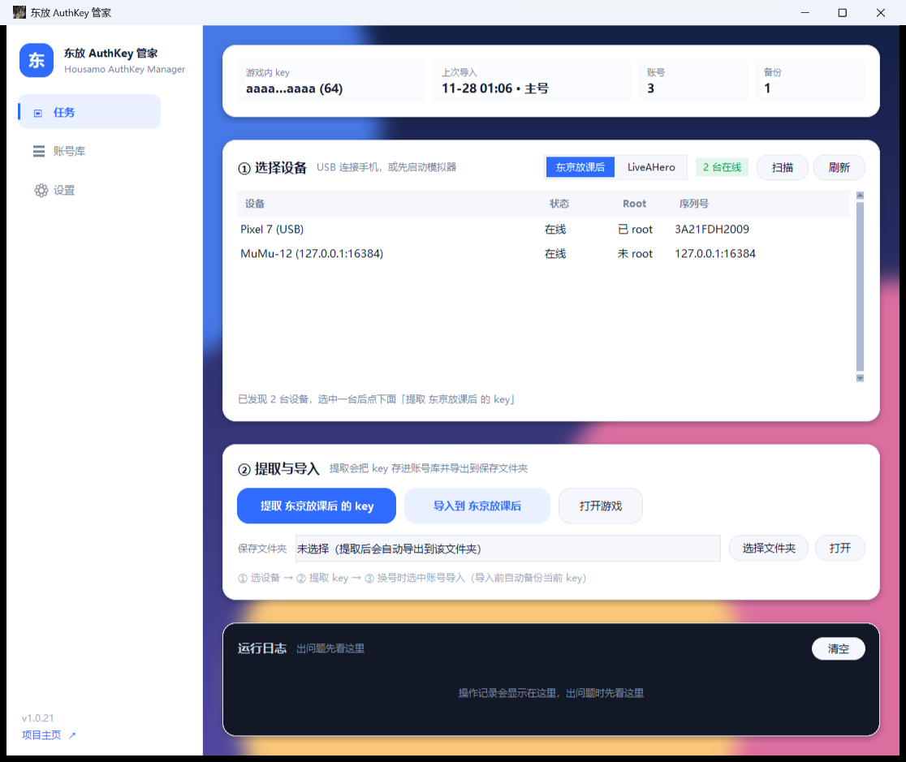
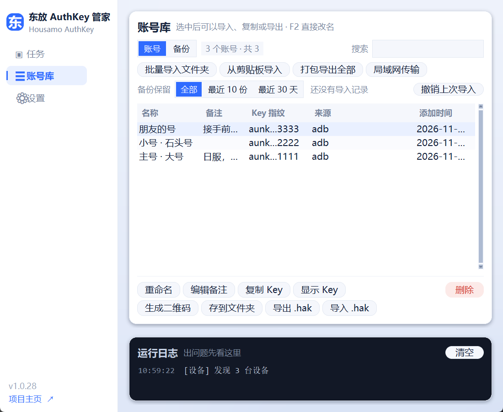
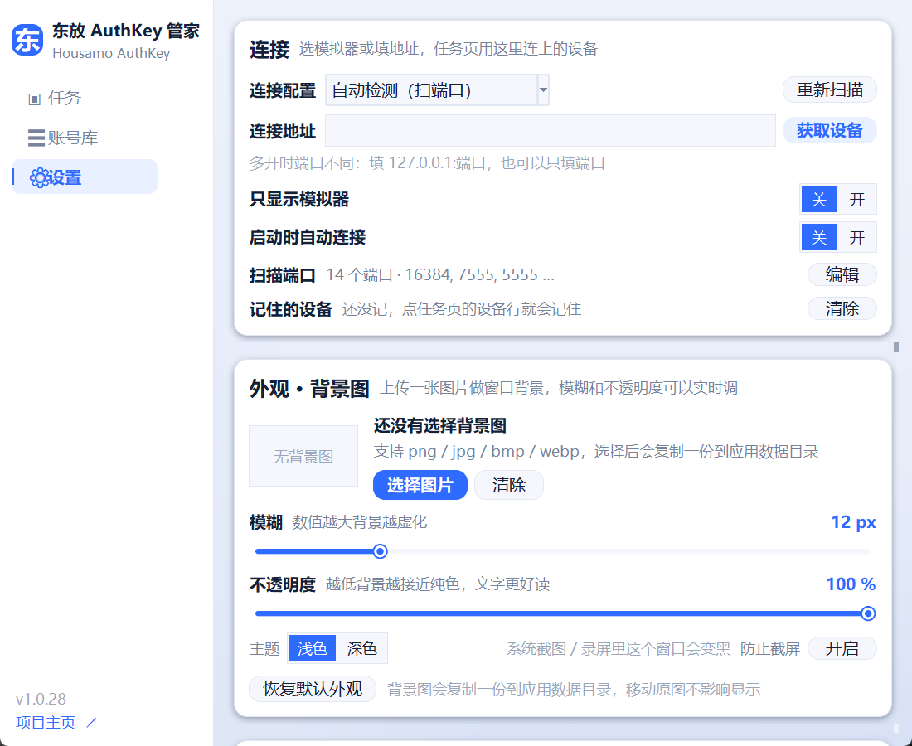

#  东放 AuthKey 管家 (Housamo AuthKey Manager)

给《东京放课后召唤师》(東京放課後サモナーズ / Housamo, 包名 `jp.co.lifewonders.housamo`) 用的 **一键备份 / 迁移 / 多开** 工具。

> **AuthKey**：一个几十~几百字节的文本文件，游戏用它记住「你是哪个账号」。删掉它，游戏会当成新号重新生成；把它复制回原位，游戏就登回原账号。本工具做的事就是**把这个文件安全地取出来、存好、再写回去**。

 

---

## 界面（Windows 端）

| 任务 | 账号库 | 设置 |
| --- | --- | --- |
|  |  |  |

重命名 / 备注 / 提取后起名用的是同一个自绘弹窗（[截图](docs/screens/win-rename.png)）：带说明、字数计数、重名提示，Enter 保存、Esc 取消，窗口能拖着走。

背景图是可选项：不选时是纯色浅底（[无背景图的样子](docs/screens/win-settings-no-bg.png)）。

---

## 功能

- **一键提取**：连上手机 / 模拟器，在任务页点选要用的那一台，点一下就把当前账号的 AuthKey 抓进账号库（自动带设备名和时间），并立刻导出成文件。
- **一键导入**：选中账号 → 自动停游戏 → 自动备份原有 key → 写入 → 回读校验，启动游戏即登录。
- **多账号管理**：重命名、指纹校验、删除、明文 `.hak` 导入导出（换电脑 / 备份用）。
- **两个游戏都支持**：《东京放课后召唤师》和 LiveAHero——两个游戏的账号、备份、导出文件夹**完全分开**，顶部点一下就切，不会混在一起、更不会互相覆盖。
- **提取即命名**：抓到 key 后弹框让你起名，同时保存一份到 `Download/东放Key/<游戏名>/<名字>/AuthKey.txt`（Android 端可在设置里改导出位置），文件管理器里直接能看到、能发给别人。
- **保存文件夹（Windows）**：选一个文件夹，之后每次提取都自动按账号名建子文件夹写 `AuthKey.txt`。
- **模拟器多开**：自动扫描 MuMu / 雷电 / 夜神 / 逍遥 / BlueStacks / 通用 5555 等端口，一台机器多开几个模拟器也能分别提取与导入；设备列表里点哪台就用哪台，选过的会记住。
- **自己选设备（Windows）**：任务页一行下拉选设备——名字、序列号一眼看到，关掉的模拟器会标「离线」；手机插着 USB、模拟器也开着时，可以开「只显示模拟器」把手机藏掉。连接入口统一收在 **设置 → 连接**：选一个预设（MuMu / 雷电 / 夜神 / 蓝叠 / 自定义）就填好地址，也可以手填 `127.0.0.1:16384`（只填端口也行）；扫描端口、启动时自动连、忘掉记住的设备都在这里。
- **外观可自定义（Windows）**：设置页可以上传一张背景图，实时调**模糊**（0-60 px）和**不透明度**（0-100%）；图片自动缩放到窗口尺寸，也可以一键「恢复默认外观」。背景图会复制一份到应用数据目录，原图删了也不影响。
- **双游戏（Windows）**：任务页顶部一个分段切换「东京放课后 / LiveAHero」，账号库按游戏分开存放（`vault.housamo.dat` / `vault.liveahero.dat`），切游戏就切库，不会写串。
- **导入前自动备份（Windows）**：每次导入前把游戏当前在用的 key 存一份，账号页「备份」分段单独列出来，随时可以还原。
- **启动核对（Windows）**：打开就比对游戏里正在用的 key 和账号库，发现没存过的会弹一条黄色提示，一点就存进账号库。
- **自动更新（Windows）**：启动时查 GitHub 最新版本，有新版就下载、校验 sha256，退出后由临时副本替换安装目录并自动重启；下载失败自动换镜像，上次没更新完下次启动会提示重试。
- **强制更新（两端）**：安全或重要修复发版时，在 Release 说明里写一行 `force-update`，客户端就只给「立即更新 / 手动下载」，没有「稍后再说」，点外面和返回键都关不掉——旧版带着问题继续跑的情况不会再发生。
- **免 root 优先**：Android 10 及以下游戏把 AuthKey 放在**外部存储**（`/sdcard/Android/data/...`），无需 root；Android 11+ 系统封了该目录，工具支持 **Shizuku**（把 adb shell 权限借给普通 App，不需要 root）与 **root** 两条通道。
- **五种导入方式（Android）**：文件夹批量导入（选中目录，把里面所有 AuthKey 收进账号库）、**从剪贴板导入**（群里发的一串 key 直接粘进来）、**扫一扫**（直接调相机，对着电脑屏幕上那张二维码拍一张）、**从相册选二维码**（已经是截图时用这个）、以及原有的「导入到游戏」。
- **账号备注 / 复制指纹 / 生成二维码（两端）**：长按账号（Android）或点工具栏（Windows）都有完整菜单；备注写「日服小号」这类随手说明，复制指纹方便跟人对账。**Windows 端账号库工具栏就有「生成二维码」**，点开是白底大图 + 指纹 + 字节数，手机对着屏幕「扫一扫」就能收，也可以用「另存为 PNG」存成文件发给别人。二维码弹窗和收 key 的界面都带**强提醒**：给出去就收不回，想让对方失效得你在自己游戏里改继承码，改完还要回来更新 key；收到分享先读满 5 秒才能点确认。
- **撤销这次导入 + 导入历史（Android）**：导入完成的弹窗上就有「撤销这次导入」，一键写回原来的 key；设置页的「导入历史」记着每次换了谁、之前的 key 备份在哪，点一条也能回退。
- **备份保留策略（Android）**：可选「全部保留 / 最近 10 份 / 最近 30 天」，超过的自动清理（默认全部保留，不会擅自删东西）。
- **打包导出全部 key（两端）**：不用每次挑文件夹——直接写进设置里的「导出位置 / 保存位置」中的游戏子文件夹，账号库里所有 key 打成一个 zip（附 `manifest.txt` 清单：指纹、字节数、创建时间、备注），换机时省事。
- **局域网传输（Android）**：手机和电脑同一个 WiFi，在 App 里打开「局域网传输」，电脑浏览器打开显示的地址就能看到账号列表并直接下载 key，配对码错的人打不开，关掉窗口即停止。
- **深色模式 / 应用锁 / 防止截屏（两端）**：设置页可切深色配色；应用锁是 4-6 位数字密码，Windows 版在打开程序时就要先输它，密码只存 PBKDF2 摘要、不存明文；防止截屏打开后系统截图和录屏里这个窗口就是黑的。
- **局域网传输（Windows）**：账号库点「局域网传输」，弹出一个带配对码的地址，手机和电脑连同一个 Wi-Fi，用浏览器打开就能逐条查看、下载 key；关掉窗口即停止。
- **首页账号概览（Android）**：一进来就能看到游戏里正在用的 key 指纹、上次自动备份的时间、账号/备份数量，点一下跳对应页面。
- **整页可滑动 + 底部图标（Android）**：首页 / 任务 / 设置三页都套了滚动容器，小屏手机上也能滑到最下面，不会被截断；底部四个菜单配了图标（首页 / 任务 / 账号 / 设置），选中时文字和图标一起变蓝。
- **每一行都有按钮（Android）**：权限、外观、安全三张卡不再靠「整行能点」这种看不出来的交互——Shizuku 授权、存储权限、重新检测、深色模式、应用锁、防止截屏，右边都是明确的蓝色按钮，按钮文字跟着状态变（已开启就显示「关闭」）。

## 仓库结构

```
.
├── win/                      Windows 桌面端（Python + tkinter）
│   ├── main.py               入口（--selftest 无窗自检）
│   ├── app/
│   │   ├── adb.py            adb 封装：设备发现、模拟器端口扫描
│   │   ├── game.py           AuthKey 路径、提取、写入、备份
│   │   ├── vault.py          账号库（DPAPI 加密落盘）
│   │   ├── dpapi.py          Windows DPAPI 加解密封装
│   │   ├── theme.py          配色 / 字体 / 版本号
│   │   ├── bgfx.py           背景图：缩放、模糊、透明度、圆角卡片渲染
│   │   ├── widgets.py        圆角卡片、胶囊按钮、滑块、标签等控件
│   │   ├── config.py         用户设置（背景图、模糊、透明度、保存文件夹）
│   │   ├── updater.py        版本比较、下载校验、副本进程替换更新
│   │   └── ui.py             主界面
│   ├── assets/platform-tools/  内置 adb（由 tools/fetch_toolchain.py 生成）
│   └── build.bat             一键打包 exe
├── android/                  Android 端（Java，无 Gradle 手工构建）
│   ├── AndroidManifest.xml
│   ├── src/com/housamo/authkey/MainActivity.java
│   ├── libs/                 Shizuku API（MIT，vendor 进来免 Gradle 依赖）
│   ├── res/                  启动图标（自适应图标 + 各密度 png，由 tools/gen_icon.py 生成）
│   └── build_apk.py          aapt2 + javac + d8 + zipalign + apksigner
└── tools/                    开发期工具（拉取 JDK / SDK / PyInstaller）
```

## 使用（Windows，推荐）

1. 到 [v1.1 Release](../../releases/tag/v1.1) 下载 `AuthKeyManager-win64.zip`，解压后双击 `AuthKeyManager.exe`（已内置 adb，无需安装 Android SDK）。
2. 手机：设置 → 关于手机 → 连点「版本号」7 次开启开发者选项 → 打开 **USB 调试** → 数据线连电脑 → 手机上点「允许调试」。
   模拟器：直接点界面上的 **扫描模拟器**。
3. 第一次用先在「保存文件夹」那一行点 **选择文件夹**（选好后每次提取都会自动导出到这个文件夹）。
4. 任务页「设备」下拉里选要用那台（手机 / 哪台模拟器；没连上的会标离线，去 设置 → 连接 连一下）→ **提取当前账号的 key** → 弹框里给它起个名字（提取完会直接存一份到第 3 步选的文件夹，并跳到账号库高亮这条）。也可以直接把 `.hak` 文件拖到窗口上导入。
5. 换号：列表里选中目标账号 → **将当前选择的 key 导入到游戏** → 处理完点 **打开游戏**。

> 账号库默认加密保存在 `%APPDATA%\HousamoAuthKeyManager\vault.housamo.dat`（LiveAHero 是 `vault.liveahero.dat`，两个游戏各一个文件；Windows DPAPI，只有当前 Windows 用户能解开）。要换机器 / 备份就用「导出 .hak」，那是明文，**别随便发给别人**。

## 使用（Android）

到 [v1.1 Release](../../releases/tag/v1.1) 下载 `HousamoAuthKeyManager-1.1.apk` 安装（Android 7.0+）。

> **两端同一个版本号、同一份 Release**：电脑版和手机版的版本号永远对齐（`win/app/theme.py` 的 `APP_VERSION` 是唯一基准，安卓的 `AndroidManifest.xml`、`build_apk.py`、`MainActivity.CURRENT_VER` 跟着它走，`versionCode` 用「1.0.x → x+1」），功能也两边一起做。改版本号时四处一起写，别只改一边。

- **有 root**：直接用，提取 / 导入都走 root 通道。
- **无 root + Shizuku（推荐给只在手机上操作的）**：
  1. 安装并启动 [Shizuku](https://shizuku.rikka.app/)。首次需要通过「开发者选项 → 无线调试」配对启动（Shizuku 自己是靠 adb 权限起的，**不需要 root**；网上有大量图文教程）。
  2. 打开本 App，在「首页 → 权限管理」里点 **Shizuku 权限** → 在 Shizuku 弹窗里点「允许」。
  3. 状态变成「Shizuku 已授权」后，提取 / 导入即可正常工作（走 shell 通道，等同 `adb pull`）。
  4. 没装 Shizuku 时点这一行会直接问你要不要跳转下载；装了但服务没起，会帮你把 Shizuku 打开。

界面分四个页签：

- **首页**（照 MAA 的排版做的）：屏幕分辨率 / 游戏版本 / App 版本 / 服务状态，运行模式，以及权限管理（Shizuku、Root、外部存储）。权限那几行点一下就能去授权，返回后自动刷新。
- **任务**：三件事——「提取当前账号的 key」「把选中的 key 复制到其他文件夹」（复制一份保留原件，或直接移动过去、把导出文件夹里那份删掉）「从一个文件夹导入 key」（选一个文件夹，把里面和子文件夹里的 AuthKey 一次全加进账号库，只是进「账号」分段，不会碰游戏里正在登录的账号；已经在库里的 key 自动跳过）。顶部先是一张「游戏」卡（东京放课后 / LiveAHero 一点就切），下面「当前账号」一行点一下跳到账号页挑 key，再下面两个操作都针对它。最下面是运行日志，每一步都有记录，出问题先看这里。导入到游戏不在这里做了，挪到账号页的蓝色主按钮上。
- **账号**：顶部两个分段「账号 / 备份」——**账号**只放你自己提取的 key（卡片显示名字、指纹、大小、导入时间、存盘路径），选中后点底部蓝色「导入到游戏」即可覆盖当前登录，「重命名 / 删除」在第二排；**备份**这一栏把「每次导入前自动存下的原 key」和「导出文件夹里扫到的 key」放在一起，卡片上的小标签会标清来源是「自动备份」还是「导出」，选中点「导入到游戏」即可还原。两个分段都显示数量。长按任意卡片会弹出操作菜单。**游戏里正在用的那个账号会标一个绿色「游戏在用」标签**，key 和别的条目一模一样的会标「重复」，一眼就能看出哪些是同一份 key。启动核对里点「存到账号库」生成的「游戏内快照 <时间>」也在这里，跟普通账号一样能导入 / 改名 / 删除。换手机、清了 App 数据，只要导出文件夹还在，进来点「重新扫描 key」就能把账号全部找回来（只会扫当前这个游戏的目录）。
- **设置**：「存储位置」一张卡里可以分别改**导出位置**和**备份位置**（每行右边都有一个蓝色「更改」按钮，一眼能看出能点），下面是权限、检查更新、项目主页（点一下跳 GitHub）、版本、清空账号库。

**两个游戏都支持（东京放课后 / LiveAHero）**：任务页和账号页顶部各有一张「游戏」卡，点一下切换。两个游戏的数据完全隔离——切过去只看到那个游戏自己的账号和备份，导入也只会写进当前这个游戏，不会把东放的 key 写进 LiveAHero。导出目录各有一个专属子文件夹：`Download/东放Key/东京放课后/` 和 `Download/东放Key/LiveAHero/`，两边同名账号也不会互相覆盖。东放老版本曾经把账号文件夹直接铺在 `Download/东放Key/` 根下，升级后这些老文件夹原地不动、照样能被识别（账号页里还是原来的路径），只是新导出的文件会进 `东京放课后/` 子文件夹。LiveAHero 的 key 在 `/sdcard/Android/data/jp.co.lifewonders.liveahero/files/datas/userKey`，和 Housamo 的 AuthKey 是同一套机制、同样大小，所以提取 / 导入 / 备份全都能用。

**每次打开都对一次账（启动核对）**：App 回到前台时会读一次当前游戏正在用的 key，如果账号库里找不到它（换过号、清过数据、或者从别处拿了个 key 直接覆盖），任务页顶部立刻出现一张黄色提示卡，写明「游戏里现在用的指纹是 xxx，账号库里没有这个 key」。想留一份就点「存到账号库」，会存成一条「游戏内快照 <时间>」并导出到文件夹；不想留点「不用管」，同一个指纹之后不再打扰。**它只提示、不自动存**，不会往账号库里塞你没要的东西。

**自动检查更新（App 内直接更新）**：每次打开 App 会自动去 GitHub 查最新 Release，**有新版就直接弹窗提示**（不藏在设置里）。点「立即更新」会当场下载 APK 并调起系统安装器覆盖安装，账号库和导出文件夹里的 key 都不动；如果系统还没允许「安装未知应用」，会先带你去开那个开关，回来自动继续装。设置页的「检查更新」也能手动触发，另有「去网页」按钮可走浏览器。

**导出位置可自选**：设置 → 导出位置 → 选一个文件夹（默认 `Download/东放Key/东京放课后/`，切到 LiveAHero 时是 `Download/东放Key/LiveAHero/`），之后每个账号都会在下面建一个以账号名命名的子文件夹，里面放 `AuthKey.txt`。

**导入前一定先备份**：每次点「导入」时，App 会先把**游戏里正在用的 key** 原样存一份到 `Download/东放Key/<游戏名>/导入前备份/AuthKey-MMdd-HHmmss-<指纹>.txt`（备份位置可以在设置里改），同时往账号库里加一条「导入前备份 <时间>」记录，然后才写入你选的 key。**如果这个 key 之前已经备份过，就直接跳过、不重复写文件**（日志里会写「已经备份过，跳过重复备份」），备份目录不会越堆越多。写完会回读校验；万一写入失败，会尝试把原 key 写回去，并在日志里说明。**换号换错了想换回去，去这个备份目录拿最新那个文件导入即可**。备份是明文，请自己保管，别随手发人。这些备份现在单独列在账号页的「备份」分段里，不再混在账号列表里。

**备份写不出来就不导入**：如果备份那一步没成功（没存储权限、空间满了等），导入会被**直接中止**，绝不会在没备份的情况下覆盖你现在登录的 key，日志里会写明原因。

**首次启动的免责声明**：第一次打开 App 会弹一个说明，必须**滚到底 + 等满 10 秒**「同意」按钮才会亮，点退出则关闭 App。里面写清了：本工具只复制文件、key 等同账号密码、备份文件在哪、覆盖风险、非官方工具、禁止盗号。

提取完会让你给账号起个名字，key 会同时进账号库，并写出 `<导出位置>/<你起的名字>/AuthKey.txt`。
- **既没有 root 也没装 Shizuku**：别慌，App 会自己告诉你怎么做——首页权限卡下面有一行蓝字，任务页正上方会直接出现一张「还差一步：读写权限」的引导卡（两种办法各配一个「怎么弄」按钮，弄好后点「我已经弄好了，检查一次」这张卡就消失）。点「提取」或「导入」时如果还没有权限，也会弹窗让你二选一，而不是只闪一句 toast。具体两条路：
  - **装 Shizuku**（免 root）：App 里点「怎么弄」会给一份五步图文（装 Shizuku → 连点版本号开开发者选项（小米是连点「OS 版本」）→ 开 USB 调试和无线调试 → 在 Shizuku 里「通过无线调试启动」配对 → 回 App 检查一次）。
  - **用电脑**：App 里点「怎么弄」会给四步说明，并提供「复制 adb 命令」按钮，直接把 `adb pull` 命令拷到剪贴板；执行和导入都在 Windows 版里做，手机不用装任何东西。
  另外**Android 10 及以下**可以不开任何权限直接读写外部 AuthKey；**Android 11 及以上系统不允许任何 App 访问 `Android/data/<其它包名>`**，这时必须用上面两种方式之一。

## AuthKey 到底在哪

| 平台 | 路径 | 需要 root |
| --- | --- | --- |
| Android | `/sdcard/Android/data/jp.co.lifewonders.housamo/files/Data/AuthKey` | 否（Android ≤10） |
| Android | `/data/data/jp.co.lifewonders.housamo/shared_prefs/jp.co.lifewonders.housamo.v2.playerprefs.xml` | 是 |
| iOS | `/var/mobile/Containers/Data/Application/<UUID>/files/Data/AuthKey` | 越狱 |

提取顺序：外部 AuthKey → root 读外部 → root 读 shared_prefs → `find` 全盘扫描兜底。

## 模拟器端口

| 模拟器 | 端口 |
| --- | --- |
| MuMu 12 | 16384 / 7555 |
| 雷电 | 5555 / 5557 / 5559 / 5565 |
| 夜神 | 62001 / 62025 / 62026 |
| 逍遥 | 21503 |
| BlueStacks | 5555 / 5565 / 5575 |
| WSA | 58526 |
| 通用 | 5555 / 5556 |

## 自己构建

**Windows 端**

```bat
python tools/fetch_toolchain.py       :: 下载 JDK / cmdline-tools / platform-tools，并复制 adb 到 win/assets
cd win
python main.py                        :: 源码运行
python main.py --selftest             :: 无窗口自检
pip install pillow pyinstaller && build.bat  :: 打包 exe -> dist\AuthKeyManager\
```

**Android 端**（不需要 Gradle）

```bash
python tools/fetch_toolchain.py    # JDK 17 + cmdline-tools + platform-tools
python tools/fetch_sdk_packages.py # platform-34 + build-tools 34.0.0
python android/build_apk.py        # -> dist/HousamoAuthKeyManager-<版本>.apk（Shizuku api 13.1.0 已 vendor 在 android/libs）
```

## 发版流程（两端同号）

**一个功能两端一起做，发版时两端同一个版本号、发同一份 Release。** 具体这么走：

1. **改版本号（四处一起改，`win/app/theme.py` 是唯一基准）**
   | 位置 | 字段 |
   | --- | --- |
   | `win/app/theme.py` | `APP_VERSION`（基准） |
   | `android/AndroidManifest.xml` | `android:versionName`、`android:versionCode` |
   | `android/build_apk.py` | `VERSION_NAME`、`VERSION_CODE` |
   | `android/src/com/housamo/authkey/MainActivity.java` | `CURRENT_VER` |

   `versionCode` 每发一版 **+1**（只要求比上一版大）。改完跑 `python tools/check_version.py` 核对四处是否一致；`win/tests/test_version_sync.py` 也会在跑测试时自动校验，不一致直接报错。

2. **功能两端都改**：电脑版在 `win/app/*`，手机版在 `android/src/com/housamo/authkey/MainActivity.java`。同一件事两边都实现，落点和提示口径保持一致（例如「打包导出全部 key」两端都跟随设置里的导出位置，两个游戏各一个子文件夹）。只改一边的功能不发版。

3. **跑测试 + 出包**

   ```powershell
   cd win
   python -m unittest discover -s tests -p "test_*.py"   # 全绿再往下走
   .\build.bat                                           # -> win\dist\AuthKeyManager\AuthKeyManager.exe
   cd ..
   python tools/make_win_zip.py                          # -> dist/AuthKeyManager-win64.zip
   python android/build_apk.py                           # -> dist/HousamoAuthKeyManager-<版本>.apk
   ```

4. **发布**：把发版说明写到 `.tmp/release_body.md`，然后 `python tools/publish_github.py`。它会从 `theme.APP_VERSION` 读版本号，把源码同步到 GitHub，建（已存在则更新）同号 Release，并把 `AuthKeyManager-win64.zip` 和对应版本的 APK 一起传上去。需要特别强调必须安装的版本，在说明里加一行 `force-update`。

## 常见问题

**提取不到 key？**
先用游戏正常登录一次（key 才会生成）；确认设备已授权调试；Android 11+ 且没有 root 时，用 Windows 版走 adb，或者在手机上装 Shizuku 并点 App 里的「Shizuku」按钮授权。不知道自己该用哪种方式的话，直接看任务页顶上那张「还差一步：读写权限」卡，两个「怎么弄」按钮里点一个跟着做就行。

**打开就卡住、不知道下一步点哪？**
任务页顶部会自动出现权限引导卡（只在真的没有权限时出现），首页权限卡下面也有一行提示；点「提取 / 导入」还会再弹一次二选一。跟着卡片上的「怎么弄」走即可，弄好之后点「我已经弄好了，检查一次」自动刷新，卡片消失。

**Shizuku 一直显示「未连接」？**
Shizuku 服务没起来（重启手机后要重新用无线调试启动一次），先打开 Shizuku App 确认它是运行状态，再回到本 App 点「刷新状态」。

**导入后游戏还是新号？**
导入前必须让游戏进程完全退出（工具会 `am force-stop`），否则游戏退出时会用内存里的状态覆盖文件。导入完再启动游戏。

**会不会被封号？**
本工具只做文件复制，不修改内存、不注入、不自动签到、不联网。账号备份 / 多开是社区长期做法，但**风险自负**，详见免责声明。

**账号库安全吗？**
Windows 端用 DPAPI 加密，绑定当前 Windows 账号；Android 端存在应用私有 SharedPreferences。导出的 `.hak` 是明文，请自行保管。

## 免责声明

本项目仅供**账号备份、迁移与多开**用途，与 LifeWonder 无关，非官方工具。请勿用于买卖账号、代练、外挂等违反游戏用户协议的行为。使用本工具造成的账号异常、数据丢失等后果由使用者自行承担。若官方提出异议，将立即停止维护。

## 更新日志

- **v1.2（安卓修复 / 两端同号）** — **切换外观不再跳回首页**：手机上在「设置 → 外观」点「切到深色 / 切到浅色」，界面会重建；以前重建时会把「上次停在哪页」重置成首页，所以每次都弹回首页，现在重建后仍停在你按按钮的那一页（换背景图、清除背景图同理）。电脑版这一版没有界面改动——它的主题切换本来就是重启后生效，不存在这个场景；版本号仍与安卓同步（1.2 / versionCode 33）。
- **v1.1（两端同号）** — **电脑版界面重写并补上安卓已有的功能**：① 换成 Qt 绘制，卡片、左栏和设置子导航都能按「卡片透明度」真正透出壁纸（文字始终不透明），壁纸模糊和透明度实时预览；② 连接设置按 MAA 重排：连接配置下拉（自动检测 / MuMu / 雷电 / 夜神 / 蓝叠 / 自定义）选完自动填地址，下面是可编辑的连接地址、ADB 路径和扫描端口；③ 账号库补齐备份分段、重命名 / 备注、二维码、还原到游戏、打包 zip、文件夹批量导入、剪贴板导入和局域网传输；④ 新增启动核对（游戏里在用的 key 不在库中时提示存一份）、自动导出明文 AuthKey.txt、自动备份和保留策略、应用锁、防截屏、设置里一键下载安装更新；⑤ Windows 程序换上角色图标和任务栏托盘图标。安卓版同步到 1.1（versionCode 32），功能不变。
- **v1.0.28（安卓）** — **「打包导出全部 key」不再每次问你要存到哪**：点下去直接把账号库所有 key 打成一个 zip，写进**设置里的导出位置**——跟单条导出完全同一个落点，两个游戏各一个子文件夹（`Download/东放Key/东京放课后/`、`Download/东放Key/LiveAHero/`），导出完的提示会告诉你 zip 存在哪个文件夹；写入依次尝试「系统授权的文件夹 → 直接写 Downloads → MediaStore → shell」，四层都失败才提示你去设置里换一个文件夹。电脑版这一版同一条也生效：zip 直接落进 **设置 → 保存位置/<游戏名>/**，不用再手选路径。另外这一版把安卓版本号对齐到 **1.0.28**，以后两端同号发布。
- **v1.0.28（Windows）** — **界面按 MAA 的思路砍繁就简**：① 任务页压成一张操作卡：顶部切游戏，一行下拉选设备（离线会标出来），一排按钮，下面留一张「最近导入」表——最近 5 次换号的时间、账号名、指纹，翻账号历史不用再开账号库。② 连接设置搬到 **设置 → 连接**，并做成 MAA 那样的连接配置：「自动检测（扫端口） / MuMu / 雷电 / 夜神 / 蓝叠 / 自定义」选一下就把地址填好，再点获取设备；下面才是连接地址、只显示模拟器、启动时自动连接。③ 扫描端口收成一行摘要（「14 个端口 · 16384, 7555, 62001 …」），点「编辑」用自绘弹窗改完整列表，长串不再被横向截掉。④ 页面比窗口高时右侧出现细滚动条，设置页不再看起来被切掉；顺手修了左侧标题和副标题被裁的问题。
- **v1.0.27（Windows）** — **key 丢了，号就没了——所以第一次提取先让你把这句读完**：从游戏里提取到 key 的前 3 次，会弹一个关不掉的提醒：它是这个账号唯一的登录凭证，丢了、被覆盖了就找不回来。弹窗里的「我知道了，去保存」必须**读满 3 秒**才变可点（按 Esc、点窗口外面都不关），提示里写清了电脑这份存在哪个文件夹、手机上再用 App 提取一次也存一份，建议网盘、邮箱各放一份；换手机、重装、清数据、刷机之前先确认这两份都还在。读完 3 次以后自动不再弹，正常保存。
- **v1.0.25（安卓）** — **从游戏提取 key 的前 3 次，先提醒你把最重要的那句读完**：提取成功后弹「这个 key 极其重要，请先读完」——它是账号唯一的登录凭证，丢了就找不回来；三步说明分别是「手机上也存一份」「电脑上也存一份（导出到 Download/东放Key/…）」「动手机之前先确认两份都在」。主按钮**读满 3 秒**才能点，期间点外面、按返回键都关不掉；读过 3 次以后不再弹。
- **v1.0.24（两端）** — **重要修复不再给跳过**：以后修安全或重要问题的版本，可以在 Release 说明里标一行 `force-update`；两端的更新提示遇到这种版本只剩「立即更新 / 手动下载」和「退出程序」，没有「稍后再说」，点外面、按返回键都关不掉，必须装上才能继续用。这一版本身就按强制更新发布，顺手让大家把前几次弹窗修复都装上。普通功能版本不受影响，还是可以稍后再说。

- **v1.0.26（Windows）** — **设备会自己更新，改名字和拖文件更顺手**：① 任务页每 9 秒静默探一次在线状态——模拟器关了、手机拔了，卡片会自己变成「离线」，不用再点刷新；这轮探测不写日志、不打断你正在做的提取/导入。② 账号库选中账号按 **F2** 直接改名；提取完会自动跳到账号库并把新账号高亮几秒，不用再自己找。③ 把 `.hak` 文件**拖到窗口上**就能导入，多个一起拖会排好队逐个处理，拖错文件只提示一句、不会乱来。④ 顺手修了账号库和设置页的排版：搜索框、批量按钮和两行工具栏以前会互相压字、把文字切掉，现在按内容自动撑开；设置里的端口列表换成等宽小字，长串不再被裁掉。
- **v1.0.25（Windows）** — **任务页能自己选设备了（参考 MAA）**：① 设备表换成可点的卡片：名字、在线 / 离线、Root、真机还是模拟器、装没装游戏一眼看到，点哪台就用哪台——提取、导入、打开游戏、启动核对全部跟着选中的那台走，选过的会记住，下次开软件自动回到它（离线了就自动退回另一台在线的）。② 手机插着 USB、模拟器也开着时，可以打开「只显示模拟器」把手机藏掉；设置页新增「连接」卡：扫描端口可改（逗号分隔）、启动时自动扫描并连接、记住的设备能一键清除，也能直接填 `127.0.0.1:16384`（只填端口也行）连一台没扫到的模拟器，端口扫描也改成并发，不再一台一台等。③ 重命名 / 备注 / 提取后起名换成自绘弹窗：带说明、字数计数、重名提示、Enter 保存、Esc 取消、窗口可以拖着走，不再是系统那个灰框。④ 设备卡会随设备数量自动长高，设备名再长也不会把按钮文字截掉。
- **v1.0.23（安卓）** — **弹窗真的不怕误触了**：「发现新版本」「收到一份 key 分享」「更新已有账号」这三个界面彻底关掉了「点外面就消失」这条路（连返回键也不关），只能点里面的「稍后再说 / 取消 / 存到账号库」。1.0.22 里这层锁写得早了一步、没生效，这次改到窗口建好之后再锁。
- **v1.0.22（Windows）** — **分享这头也加了把门**：①「生成二维码」弹窗和 `.hak` 导入的提示都改成强提醒——这把 key 给出去就收不回，想让对方失效得**你自己**在游戏里改继承码，改完还要回来把 key 更新一遍，否则会把自己顶下线。② 导入 `.hak` 时如果库里已经有同名条目或同一个 key，不再直接写库，先弹「收到一份 key 分享」：列出指纹、字节数和冲突的那条，**读满 5 秒**「替换那条 / 另存为新条目」才可点。③ 启动核对多了「更新已有账号」：游戏里 key 换了（改过继承码、重装过），选中原来的账号一键原地换 key，旧 key 自动进备份，名字和备注都不变。
- **v1.0.21** — **扫码这头加了把门**：① 手机「扫一扫 / 从相册选二维码」识别成功后先开「收到一份 key 分享」，显示来源、指纹、字节数；库里已有同一个 key 会直接标出来（不会闷头重复存）；确认按钮**读满 5 秒**才变可点。② 生成二维码的弹窗提示同步改成强提醒（给出去收不回 / 号主自己改继承码 / 改完回来更新 key）。③ 启动核对的黄条多了「更新已有账号」：游戏里的 key 对不上库时，选一条原来的账号把 key 原地换掉，旧 key 自动存成备份。
- **v1.0.21（Windows）** — **把手机端的顺手功能搬过来了**：① 账号库工具栏新增「局域网传输」——点开是一个带配对码的网址，手机连同一个 Wi-Fi 用浏览器打开就能逐条看、逐条下载 key，关掉窗口立即停止。② **深色模式**：设置页「主题」一键切浅色 / 深色，整窗即时换色（保留当前页、账号列表和操作日志，不用重启），深色下二维码仍是白底、不反色。③ **应用锁**：设置页「数据与存储」里设 4-6 位数字密码，下次打开程序先弹解锁窗；密码只存 PBKDF2-SHA256 摘要和随机盐，设置文件里看不到明文，连错 5 次窗口自动关掉。④ **防止截屏**：打开后系统截图和录屏里这个窗口会变黑（Windows 10 2004+ 的 `WDA_EXCLUDEFROMCAPTURE`，老系统会提示不支持）。三张卡放不下时设置页自动隐藏日志卡、仍放不下就整页滚动。
- **v1.0.20** — **两头都能二维码了**：① **Windows 账号库工具栏多了「生成二维码」**——选中账号点一下，弹出白底大图（旁边写着账号名、指纹和字节数），手机 App 里点「扫一扫」对着屏幕拍一张就收进账号库；也可以用「另存为 PNG」把二维码存成图片发给别人。② **手机端「扫一扫」真的调相机了**：任务页原来那张「从二维码图片导入 key」拆成两张——「扫一扫二维码」直接打开系统相机，拍完自动识别；「从相册选二维码」留给已经是截图的情况。相机打不开（没装相机 App、权限被拒）会自动退回相册选图，不会卡在那儿。
- **v1.0.19** — **界面顺手了**：①首页 / 任务 / 设置三页改成整页可滑动，小屏也不会「下面那截看不见」②底部四个菜单加上图标（房子 / 清单 / 人 / 滑块），选中时图标和文字一起变蓝 ③设置页权限、外观、安全三张卡的每一行都加了明显的蓝色按钮——Shizuku「授权」、存储「去设置」、重新检测「刷新」、深色模式「切到深色 / 切到浅色」、应用锁「开启 / 关闭」、防止截屏「开启 / 关闭」④安全两行还会写清当前状态（比如「已禁止：系统截图和录屏是黑的」）；关应用锁要先输一次现在的密码。
- **v1.0.18** — **一口气加了 13 项功能**：①从剪贴板导入 key（含整段 playerprefs xml）②账号备注 ③账号页也有「从文件夹导入」入口 ④长按复制指纹 ⑤修掉账号页「N 个备份」和分段数字对不上的计数 bug ⑥导入完成可「撤销这次导入」⑦应用锁（4-6 位数字密码）+ 防止截屏 ⑧导入历史时间线（可点一条回退）⑨自动备份保留策略（全部 / 最近 10 份 / 最近 30 天）⑩打包导出全部 key 为 zip（带 manifest 清单）⑪生成 / 扫描二维码导入 ⑫局域网传输（电脑浏览器直接下载 key）⑬深色模式 ⑭首页账号概览卡。另外把「检查更新」改成只认带 APK 的 Release——之前 Windows 端的 `v1.1` 发布会让手机版误以为要更新。
- **v1.0.17** — **从一个文件夹导入 key**：任务页新增第三张卡。点「从一个文件夹导入 key」，用系统文件选择器选一个目录（`Download/东放Key` 这种备份目录、U 盘、网盘目录都行），App 会把该目录和它下面几层子文件夹里看着像 key 的文件全读出来——名字带 `key` / `authkey`、或者 `.txt` / 无扩展名的文件，内容是 16~512 位不含空格的字符串才算；顺手也认 playerprefs.xml。扫完先弹一张卡片，列清楚「找到 N 个、每个的指纹和字节数、其中几个已经在库里会被跳过」，你点「全部导入」才真的写进**「账号」分段**——只是进账号库，游戏里正在登录的账号一点不动；要真切换登录，还是去账号页选中它、点底部蓝色「导入到游戏」（导入前照旧自动备份现在的 key）。Android 11+ 的文件选择器有时不让 App 直接遍历目录，这时会自动改用存储路径再扫一遍，不需要你额外授权。导入的账号名默认取它所在的文件夹名，重名会自动加 ` 2`。

- **v1.0.16** — **弹窗全部重做**：之前的提示框是系统默认样式（绿按钮、方角、一堆挤在一起的小字），这版全部换成自绘的白色圆角卡片——标题 17 号加粗，说明文字换成柔和的灰蓝，多步骤的地方用蓝色数字圆点一步步排下来，可选的路线做成整块能点的浅灰卡片，主操作是整宽的蓝色圆角按钮，次要操作收在下面一排灰色小字按钮里。重做的有：应用内更新提示、Shizuku 五步图文、电脑路线、无权限提示、Shizuku 未安装 / 未启动、导入到游戏的确认框、导入完成、长按账号卡片弹出的菜单、复制到其他文件夹、重命名、删除、清空账号库、给账号取名字。确认框里会直接写明目标账号的指纹和游戏里现在用的指纹；菜单项旁边加了一行灰字说明这一项到底做了什么。功能没有任何删减，只是把长相统一了。
- **v1.0.15** — **没有 root / 没装 Shizuku 时不再卡壳**：以前只有一句 toast 或者一行红字，新用户根本不知道下一步该干什么。这版在任务页正上方加了一张「还差一步：读写权限」引导卡（有权限时自动隐藏），把两条可行路线摆出来——① Shizuku（免 root）② 电脑 + USB 线，各自配一个「怎么弄」按钮：Shizuku 给五步图文（含小米「连点 OS 版本」这种容易卡住的地方），电脑路线给四步说明外加「复制 adb 命令」按钮。卡片底部有「我已经弄好了，检查一次」，点一下重新检测 root / Shizuku，有权限了卡片立刻消失、账号页的「游戏里现在用的」也自动刷新。点「提取」「导入到游戏」时若仍无权限，不再只闪一句提示，而是弹窗让你从两种方式里选一个。首页权限卡下面也加了一行说明。顺带把构建脚本里 d8 的参数改成先打 jar（类文件太多时会超过 Windows 命令行长度上限）。
- **v1.0.14** — **东放也有专属文件夹了**：以前只有 LiveAHero 有 `Download/东放Key/LiveAHero/`，东放的账号文件夹直接铺在 `Download/东放Key/` 根下，两个游戏的导出混在一起。这版把东放也收进 `Download/东放Key/东京放课后/`，导出位置、备份位置（`Download/东放Key/东京放课后/导入前备份/`）都跟着变，设置页里能直接看到完整路径。**老文件不会丢**：升级后 `Download/东放Key/` 根下原有的账号文件夹仍然会被扫描识别（账号页里照旧显示老路径），只是新导出的进子文件夹；SAF 自选的导出/备份目录也是同样逻辑。


- **v1.0（Windows）** — Windows 桌面端首个版本：左侧胶囊导航 + 右侧圆角卡片的界面，可上传背景图并实时调模糊（0-60 px）与不透明度（0-100%），设置页分「外观 · 背景图」「更新」「数据与存储」三块；高分屏下声明 DPI 感知并等比放大，125% / 150% 不再发虚；**双游戏**（东京放课后 / LiveAHero 各一个账号库 `vault.housamo.dat` / `vault.liveahero.dat`，老的 `vault.dat` 首次启动自动改名）；**导入前自动备份**（账号页「备份」分段，可还原，备份条目不能改名改备注）；**启动核对**（游戏里正在用的 key 不在库里时顶部黄条提示，一点存成「游戏内快照」）；**自动更新**（查 releases/latest，整包下载 + sha256 校验 + gh-proxy / ghfast 镜像回退，临时副本等主程序退出后替换安装目录并重启，`update_state.json` 记状态，目录不可写时退回手动下载）；单实例运行；表格长内容按列宽自动省略（指纹保留长度后缀）。

- **v1.0.13** — **多游戏支持**：新增 LiveAHero（`jp.co.lifewonders.liveahero`），任务页和账号页顶部各有一张「游戏」切换卡，两个游戏的账号 / 备份 / 导出文件夹完全隔离（后装的游戏导出到 `Download/东放Key/LiveAHero/`，东放沿用老路径、老数据不动）；没装的那个游戏按钮会是半透明、并提示未安装。新增**启动核对**：每次回到 App 都读一次游戏里正在用的 key，账号库里没有的话在任务页顶上弹一张黄色提示卡，写明当前指纹，点「存到账号库」才存成「游戏内快照 <时间>」，点「不用管」则同一指纹不再打扰——只提示不自动存，不会塞一堆你没要的条目。

- **v1.0.12** — 按"精简任务页"的意见改版：任务页只剩「提取当前账号的 key」和「把选中的 key 复制到其他文件夹」（复制可选"复制一份"或"移动过去"），导入到游戏统一挪到账号页的蓝色主按钮；彻底删掉「复制 key 到剪贴板」这个重复功能；账号页的「备份」分段现在同时列出"每次导入前自动备份"和"导出文件夹里的 key"，并用「自动备份」「导出」小标签区分来源；设置页把导出/备份位置改成一张「存储位置」卡，两行各带一个明显的蓝色「更改」按钮，**备份位置现在也能自己选**；导入前备份加了去重——同一个 key 已经备份过就跳过，不再重复写文件。

- **v1.0.11** — 账号页操作重排：底部主按钮变成蓝色全宽的「导入到游戏」（选中账号后一点就覆盖当前登录，之前这里是「复制」，现在复制挪到第二排），点导入会先弹确认框，写清要导入哪个账号、游戏里现在用的是哪个指纹、导入前会自动备份；卡片上会用绿色「游戏在用」标出游戏当前正在用的账号、用「重复」标出 key 完全相同的条目；导入成功后直接问「要不要现在打开游戏」，点一下就跳过桌面；长按卡片弹出操作菜单。
- **v1.0.10** — 全新应用图标：把角色立绘做成自适应图标（Android 8+ 各种圆/方/水滴形状里都能正确裁切，低版本用传统方形图标）；设置页与桌面图标保持一致。
- **v1.0.9** — 账号页改版：账号与备份分成两个分段、各自独立列表；账号卡片重做（加粗名称 + 指纹/大小/时间 + 存盘路径 + 选中勾选圈），备份卡片标成琥珀色并支持「导入到游戏」一键还原；修掉长按在备份页会复制 key 的行为。
- **v1.0.8** — 修掉设置页「版本」写死成 1.0.5 的显示错误，现在直接读系统里的真实版本号（如 1.0.8 (9)）；其余与 1.0.7 相同。
- **v1.0.7** — 支持 App 内直接更新：启动发现新版本就弹窗，点「立即更新」当场下载并覆盖安装（不再跳浏览器）；**备份失败则中止导入**，绝不在没备份的情况下覆盖原 key。
- **v1.0.6** — 账号页自动读取导出文件夹里的 key（App 数据丢了文件夹还在就能恢复）；导入前自动备份原 key 到 `Download/东放Key/导入前备份/`，任务页显示最近一次备份路径，写入失败会自动回写原 key；首次启动弹免责声明，必须读完并等满 10 秒才能同意；Windows 端按钮文案同步改成「提取当前账号的 key」「将当前选择的 key 导入到游戏」。
- **v1.0.5** — 设置页补上「项目主页」一键跳转；每次启动自动检查更新；修掉若干界面细节。
- **v1.0.4** — 界面文案与排版微调。
- **v1.0.3** — 界面重做成白卡三页签（任务 / 账号 / 设置）；提取后可自己命名，并导出到 `Download/东放Key/<名字>/AuthKey.txt`；Windows 端可选择保存文件夹，提取后自动按名字分文件夹保存；写 AuthKey 改为原地覆盖（`cat >`），保留原属主与权限，避免 `cp` 后文件变成 shell 所有导致游戏读不到。
- **v1.0.2** — Android 端接入 Shizuku，无 root 也能在手机上提取 / 导入；最低系统要求升到 Android 7.0。
- **v1.0.1** — 修复 Android 11+ 包可见性导致「游戏：未检测到」。
- **v1.0.0** — 首发：Windows 桌面端 + Android 端。

## 致谢

- [Shizuku](https://github.com/RikkaApps/Shizuku-API)（MIT）—— 免 root 的 shell 通道。
- 社区里关于 AuthKey 路径的各种总结。

## License

MIT
